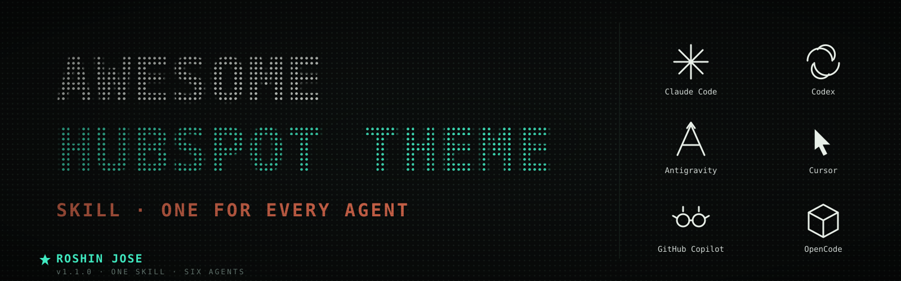

<p align="center">
  
</p>

<h1 align="center">Awesome HubSpot Theme Skill</h1>

<p align="center">
  <em>One skill, six agents.</em> Turn a one-line brief like
  <code>Create a HubSpot theme for a [your industry] business.</code>
  into a full, production-ready HubSpot CMS theme — fields.json, modules, centralized CSS/JS, the works.
</p>

<p align="center">
  <strong>Author:</strong> Roshin Jose ·
  <a href="mailto:roshinjose1@gmail.com">roshinjose1@gmail.com</a> ·
  <a href="tel:+919645228131">+91 96452 28131</a><br>
  <strong>Version:</strong> 3.0.0  ·
  <strong>Works in:</strong> Claude Code · OpenAI Codex · Google Antigravity · Cursor · GitHub Copilot · OpenCode
  <em>(and any <a href="https://agents.md">agents.md</a>-compatible agent — Cline, Aider, etc.)</em>
</p>

---

A single AI skill that turns a one-line brief into a full HubSpot CMS theme — `theme.json`, a complete `fields.json` global settings panel, centralized `main.css` / `main.js`, and a catalog of ~50 reusable modules. Cross-tool: works in **Claude Code**, **OpenAI Codex**, **Google Antigravity**, **Cursor**, **GitHub Copilot**, and **OpenCode**.

> **v3.1.0 — forms, editor-canvas & CSS-layer hardening.** Updated against five recent production builds — **Aagard, KineticGPO, Ondex Automation (ACI), Meridian IT, Minitab**. Adds the CSS-first animation architecture (GSAP/Lenis removed from production Apr 2026), the KineticGPO section-shell standard, the compact token-panel option, the two-step token-bridge contract, the FontAwesome-5 icon-validation trap, zero-mandatory-fields policy, idempotent JS init, and ~10 new upload-validation rules. See [Versioning](#versioning) for the full change log.
>
> **Sibling skill:** [`hubspot-landing-builder`](../hubspot-landing-builder/) — same rule base, scoped to single campaign/landing pages composed inside an existing theme (or fully standalone), instead of scaffolding a whole theme.

## Quick install

| Tool | One-liner |
|------|-----------|
| **Claude Code** | `git clone https://github.com/Roshinjose167/Awesome-HubSpot-Theme-Skill.git ~/.claude/skills/hubspot-theme-builder` |
| **Cursor** *(in your theme repo)* | `mkdir -p .cursor/rules && curl -fsSL https://raw.githubusercontent.com/Roshinjose167/Awesome-HubSpot-Theme-Skill/main/prompts/cursor-rules.mdc -o .cursor/rules/hubspot-theme-builder.mdc` |
| **GitHub Copilot** *(in your theme repo)* | `mkdir -p .github && curl -fsSL https://raw.githubusercontent.com/Roshinjose167/Awesome-HubSpot-Theme-Skill/main/prompts/copilot-instructions.md -o .github/copilot-instructions.md` |
| **OpenCode / Cline / Aider** *(in your theme repo)* | `curl -fsSL https://raw.githubusercontent.com/Roshinjose167/Awesome-HubSpot-Theme-Skill/main/prompts/opencode-AGENTS.md -o AGENTS.md` |
| **Codex / Antigravity** | Open [`prompts/codex-system-prompt.md`](prompts/codex-system-prompt.md) or [`prompts/antigravity-system-prompt.md`](prompts/antigravity-system-prompt.md) on GitHub, copy the body, paste as the agent's system prompt. |

Then in any of those tools type your brief, e.g.:

```
Create a HubSpot theme for a [your industry] business.
```

Concrete examples that work well:

- `Create a HubSpot theme for a modern healthcare clinic.`
- `Build a HubSpot theme for a B2B SaaS startup with a developer audience.`
- `Generate a HubSpot CMS theme for a boutique law firm — calm, premium, navy + gold palette.`
- `Make me a HubSpot theme for a logistics company. Use defaults.`

Per-tool detail and explanation of how each agent picks up the file is in [How to use — per tool](#how-to-use--per-tool) below.

## What this skill does

You type a brief like:

```
Create a HubSpot theme for a [your industry] business.
```

and the agent produces a production-ready theme with:

- Complete **Theme Settings** panel exposing every brand token an editor would touch (colors, typography, header, buttons, forms, tables, spacing, footer, blog, layout & structure)
- A `:root` CSS-variable layer driven entirely by theme tokens — no hardcoded values
- ~50 modules across hero, content, navigation, interactive, forms, data display, media, feedback
- Buttons that reuse a single global Primary/Secondary style — never redefined per-module
- Mobile-first stacking rules baked in
- Validation checklist before the agent reports "done"

The full instruction set is in [`SKILL.md`](SKILL.md). Reference docs:

- [`reference/architecture-rules.md`](reference/architecture-rules.md) — CSS/JS centralization, token discipline, button reuse, mobile rules, sticky-header pattern, blog template patterns, build order
- [`reference/theme-fields-spec.md`](reference/theme-fields-spec.md) — every `fields.json` group with the exact JSON shape, plus the full CSS variable map
- [`reference/modules-spec.md`](reference/modules-spec.md) — every module, every field, with the OneIMS production patterns (whole-card click, equal-height carousels, icon library + custom SVG choice, per-row repeater color pickers, `item_id` for content-heavy repeaters)
- [`reference/hubl-gotchas.md`](reference/hubl-gotchas.md) — `blog_recent_posts` (NOT `related_blog_posts`), `/hs-search-results` blog search form, nested-repeater visibility workaround, sticky-header scroll-direction pattern, mobile logo, featured-grid-under-search, date formatting, pagination orphans, video featured image, favicon dark mode
- [`reference/upload-validation.md`](reference/upload-validation.md) — every `hs upload` error the OneIMS team has hit, with exact error string and fix (reserved field names, icon field default shape, `text` type in theme fields.json, `responsive_breakpoints` enum, `meta.json` `categories` enum, font/color/image field shapes)

## Supported tools

| Tool | File you install | Where it goes | Self-contained? |
|------|------------------|---------------|-----------------|
| **Claude Code** | `SKILL.md` (this folder) | symlinked into `~/.claude/skills/hubspot-theme-builder` | ✓ (loads `reference/*.md` on demand) |
| **OpenAI Codex** | [`prompts/codex-system-prompt.md`](prompts/codex-system-prompt.md) | paste as system prompt | ✓ |
| **Google Antigravity** | [`prompts/antigravity-system-prompt.md`](prompts/antigravity-system-prompt.md) | paste as system prompt | ✓ |
| **Cursor** | [`prompts/cursor-rules.mdc`](prompts/cursor-rules.mdc) | copy to `<project>/.cursor/rules/hubspot-theme-builder.mdc` | ✓ |
| **GitHub Copilot** | [`prompts/copilot-instructions.md`](prompts/copilot-instructions.md) | copy to `<project>/.github/copilot-instructions.md` | ✓ |
| **OpenCode** (and any [agents.md](https://agents.md)-compliant agent: Cline, Aider, etc.) | [`prompts/opencode-AGENTS.md`](prompts/opencode-AGENTS.md) | copy to `<project>/AGENTS.md` | ✓ |

All paste-in files inline the full spec, so the receiving agent needs no other files. The Claude Code skill stays modular (loads `reference/*.md` on demand) — when you change `SKILL.md` or `reference/*.md`, regenerate the paste-in copies (see "Updating the skill" below).

## How to use — per tool

### Claude Code

Symlinked once at install time (see "Install" below). After install, run Claude Code in any working directory and type:

```
Create a HubSpot theme for a [your industry] business.
```

The trigger phrase in `SKILL.md`'s frontmatter matches and the agent loads the full instruction set automatically. To invoke explicitly: `/hubspot-theme-builder Create a HubSpot theme for a [your industry] business.`

### OpenAI Codex

1. Open Codex (codex.com or the Codex CLI).
2. Copy the prompt to your clipboard:
   ```bash
   curl -fsSL https://raw.githubusercontent.com/Roshinjose167/Awesome-HubSpot-Theme-Skill/main/prompts/codex-system-prompt.md | pbcopy
   ```
   *(or just open [the file on GitHub](https://github.com/Roshinjose167/Awesome-HubSpot-Theme-Skill/blob/main/prompts/codex-system-prompt.md) and copy it manually)*
3. Paste it as the **system prompt** in Codex.
4. Send your brief, e.g. `Create a HubSpot theme for a [your industry] business.`

### Google Antigravity

1. Open Antigravity, open the agent's system prompt configuration.
2. Copy the prompt:
   ```bash
   curl -fsSL https://raw.githubusercontent.com/Roshinjose167/Awesome-HubSpot-Theme-Skill/main/prompts/antigravity-system-prompt.md | pbcopy
   ```
   *(or open [the file on GitHub](https://github.com/Roshinjose167/Awesome-HubSpot-Theme-Skill/blob/main/prompts/antigravity-system-prompt.md) and copy it.)*
3. Paste it as the system prompt.
4. Start a new conversation with your brief.

### Cursor

In your HubSpot theme project root:

```bash
mkdir -p .cursor/rules
curl -fsSL https://raw.githubusercontent.com/Roshinjose167/Awesome-HubSpot-Theme-Skill/main/prompts/cursor-rules.mdc \
  -o .cursor/rules/hubspot-theme-builder.mdc
```

Cursor picks it up automatically. The `globs` in the file's frontmatter activate the rule when you're editing `theme.json`, `fields.json`, anything inside `*.module/`, or `*.hubl` files. To invoke unconditionally, type `@hubspot-theme-builder` in Cursor chat. Send your brief.

### GitHub Copilot (Copilot Chat in VS Code, JetBrains, Visual Studio, github.com)

In your HubSpot theme repo root:

```bash
mkdir -p .github
curl -fsSL https://raw.githubusercontent.com/Roshinjose167/Awesome-HubSpot-Theme-Skill/main/prompts/copilot-instructions.md \
  -o .github/copilot-instructions.md
git add .github/copilot-instructions.md && git commit -m "Add Copilot instructions for HubSpot theme work"
```

Copilot Chat reads `.github/copilot-instructions.md` automatically for every chat in this repo. No further config. Send your brief in Copilot Chat.

### OpenCode / Cline / Aider / any [agents.md](https://agents.md)-compatible agent

In your HubSpot theme project root:

```bash
curl -fsSL https://raw.githubusercontent.com/Roshinjose167/Awesome-HubSpot-Theme-Skill/main/prompts/opencode-AGENTS.md \
  -o AGENTS.md
```

Run OpenCode (or your agent of choice). It reads `AGENTS.md` automatically. Send your brief.

## Install (one-time, Claude Code only)

```bash
git clone https://github.com/Roshinjose167/Awesome-HubSpot-Theme-Skill.git \
  ~/.claude/skills/hubspot-theme-builder
```

Restart Claude Code. Verify with `/skills` — `hubspot-theme-builder` should appear.

To pull future updates: `cd ~/.claude/skills/hubspot-theme-builder && git pull`.

The Codex / Antigravity / Cursor / Copilot / OpenCode files don't need a global install — they live alongside the project that uses them, copied in as shown above.

## What inputs the skill collects — the brand-first two-phase flow

This is a **brand-first** skill (since v2.1.0). The agent does not build with silent defaults, even in auto/yolo mode:

1. **Phase 0 — brand intake (blocking).** On first invocation the agent asks for the client brand guideline in one organized message covering 9 areas: theme identity · colors · typography · buttons · layout · assets (logos/favicon) · forms/tables/blog overrides · motion & voice · constraints. It echoes back what it captured, flags every default it will fall back to, and **waits for explicit confirmation**.
2. **Phase 1 — Theme Settings foundation (ship, then stop).** theme.json + fields.json + the token emitter + main.css/main.js baseline + base layout + header/footer partials — populated with the *client's* values. The agent then stops and asks you to upload and verify the brand renders correctly in HubSpot before it scaffolds any modules.
3. **Phase 2 — modules + templates**, only after you approve the foundation.

Fast path: replying "use defaults" (an explicit grant) lets the agent proceed with the documented skill defaults (`Inter`, `#E74C3C / #0D899E / #1A1A1A`, 1300px/70px, 767px breakpoint) — but the two review checkpoints still apply.

## Hard rules the agent follows

- **Non-destructive.** Never renames or deletes existing theme files.
- **Theme tokens are the only source of truth.** No hardcoded hex/font/px in modules. All emitted via `css/theme-overrides.css.html`.
- **CSS/JS centralized** in `main.css` / `main.js`. Modules don't ship `<style>` or `<script>` tags.
- **Buttons reuse global Primary/Secondary.** Modules expose `style: primary | secondary` choice, never their own button styling.
- **Mobile breakpoint `767px`** (universal OneIMS convention, NOT 768px). Media-above-content in any two-column layout.
- **Accessibility + legibility**: alt fields, focus states, off-black body text (`#111111`, never `#000000`), line-height ≥ 1.6, ≥4.5:1 contrast.
- **Upload-validation aware** — avoids the reserved field-name list, validates icon-field defaults, only emits the `mobile` `responsive_breakpoints` entry, uses only the documented `meta.json` `categories` enum, never calls `related_blog_posts`. Full catalog in [`reference/upload-validation.md`](reference/upload-validation.md).

Full rule list is in `SKILL.md` under "Hard rules".

## File map

```
aihubspotthemeskill/
├── SKILL.md                         ← main instruction set (Claude reads this)
├── README.md                        ← this file
├── reference/
│   ├── architecture-rules.md        ← CSS/JS centralization, tokens, button reuse, mobile, sticky header, blog template patterns
│   ├── theme-fields-spec.md         ← exact fields.json JSON for every group + full CSS variable map
│   ├── modules-spec.md              ← per-module fields + production patterns (whole-card click, equal-height carousels, icon library + custom SVG)
│   ├── hubl-gotchas.md              ← blog search, blog_recent_posts, nested-repeater visibility, sticky-header scroll, favicon dark mode
│   └── upload-validation.md         ← every `hs upload` error + exact fix (reserved names, icon shape, responsive_breakpoints, categories enum)
└── prompts/
    ├── antigravity-system-prompt.md ← paste into Antigravity (self-contained)
    ├── codex-system-prompt.md       ← paste into Codex (self-contained)
    ├── cursor-rules.mdc             ← copy to <project>/.cursor/rules/
    ├── copilot-instructions.md      ← copy to <project>/.github/copilot-instructions.md
    └── opencode-AGENTS.md           ← copy to <project>/AGENTS.md (works for OpenCode/Cline/Aider)
```

## Updating the skill

Edit `SKILL.md` or any `reference/*.md` and the next conversation picks up the change — no restart needed for Claude Code skill content (only for skill registration).

When you change the spec in `SKILL.md` / reference docs, also update the five inlined copies in `prompts/` — they're snapshots, not symlinks. Each one shares the same body content; only the header wrapper differs (paste-target, file-path comment, etc.).

```bash
cd <repo>/prompts

# 1. Edit the canonical body in antigravity-system-prompt.md.
# 2. For each other file, replace the body (everything after the wrapper header)
#    with the new body. The wrappers stay tool-specific.

# Then commit and push so all consumers get the update.
```

## Versioning

| Version | Date       | Notes                                                                                                            |
|---------|------------|------------------------------------------------------------------------------------------------------------------|
| 1.0.0   | 2026-04-26 | Initial release. Layout & Structure group, ~50 modules, paste-in prompts for Claude / Antigravity / Codex.       |
| 1.1.0   | 2026-04-26 | Added Cursor (`.cursor/rules/*.mdc`), GitHub Copilot (`.github/copilot-instructions.md`), and OpenCode/agents.md. |
| 2.0.0   | 2026-06-04 | Major rewrite against the OneIMS production catalog (Aagard, Minitab, Smartguard, Devpulse, Logistics, Healthcare, Legal Law, MyGovBill, ~30 more). Encodes every upload-validation pitfall (reserved field names, icon defaults, `responsive_breakpoints` enum, `meta.json` categories, nested-repeater visibility, `blog_recent_posts`). Adds [`reference/hubl-gotchas.md`](reference/hubl-gotchas.md) and [`reference/upload-validation.md`](reference/upload-validation.md). Mobile breakpoint corrected to **767px**. Default font changed from `Plus Jakarta Sans` to **`Inter`** (matches production). Body text default `#111111` (off-black). Adds production module patterns: whole-card click, equal-height carousels, icon library + custom SVG choice, per-row color pickers inside repeaters, optional `item_id` for content-heavy repeaters, sticky-header scroll-direction toggle, mobile-logo-always-linked, `/hs-search-results` blog search, featured-grid-flatten-under-search, blog date format, pagination orphan avoidance, video featured-image workaround, favicon dark mode. |
| 2.1.0   | 2026-06-04 | Brand-first two-phase build: Phase 0 brand intake → Phase 1 Theme Settings foundation → review checkpoint → Phase 2 modules + templates. Auto-mode explicitly overridden at both checkpoints. |
| 3.0.0   | 2026-07-29 | Re-hardened against five 2026 production builds (**Aagard, KineticGPO, Ondex/ACI, Meridian IT, Minitab**). **Animation architecture:** GSAP/Lenis removed (production commit Apr 2026) → Animista keyframe library + `data-animate`/`data-animate-delay` + one IntersectionObserver, default-visible CSS with `.is-pending` applied by JS, `` guard, `animationend` → `.animation-complete` cleanup, rAF-throttled passive scroll, `prefers-reduced-motion`. **Section shell:** standardized `spacing` + `background` groups (`controlling_field_path` visibility) + `anchor_id` on every section module. **Token bridge:** two-step emitter (HubL `` → `:root`), documented load-order contract, `main.css` hardcoded fallbacks, bare-element-only typography scoping, `color()` macro. **Panel:** compact ~6-group KineticGPO-style token-panel option with role-annotated labels; `sorting_label_field` + populated repeater defaults; zero `required` fields. **New validation rules:** FA-5.0.10 icon validation (prefer inline-SVG choices), `hubdbrow` publish-before-upload, no `blog_post` field type, STYLE-tab field whitelist, `dnd_section` param whitelist, CSS-formatter-mangled HubL detection, field-`name`-not-`id` emission, token-path drift check, undeclared `var(--x)` check, repo hygiene (`* copy.json`, duplicate module dirs, `module_id`), extended reserved-name list (`class`, `style`, `content`, `tag`), canonical `responsive_breakpoints` full shape. **Button rule generalized:** one global family, per-project naming; adopt the existing family when extending. Sibling skill **hubspot-landing-builder** introduced. |
| 3.1.0   | 2026-10-23 | **Forms, editor-canvas & CSS-layer hardening** (hubl-gotchas sections 23-27). Adds: HubSpot default form-CSS reset (fieldset `max-width:500px`, `.hs-input` 95%, floated checkboxes to a grid + `!important` checkbox pin); dict-method field-name collisions (`copy`/`items`/`keys`/`values`/`get`/`pop`/`update` shadow Python dict methods and break the local Jinja2 harness while rendering fine on HubSpot); `overflow-x: clip` on html/body collapses the HubSpot editor canvas height (use `body{overflow-x:hidden}`); `backdrop-filter` on a fixed header breaks sticky-nav containment (move the filter to an inner wrapper); `module.css` outranks skin layers (keep modules to 2-3 structural classes, theme via tokens, harness must load the skin). |

## Author

**Roshin Jose**
Email: [roshinjose1@gmail.com](mailto:roshinjose1@gmail.com)
Phone: [+91 96452 28131](tel:+919645228131)

For bug reports, feature requests, or licensing questions, reach out via email.
